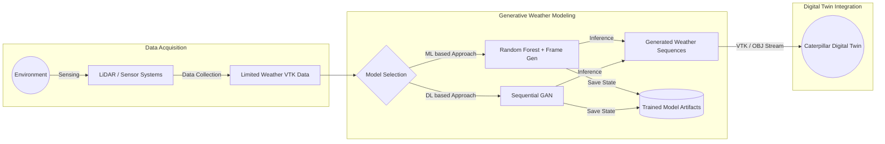
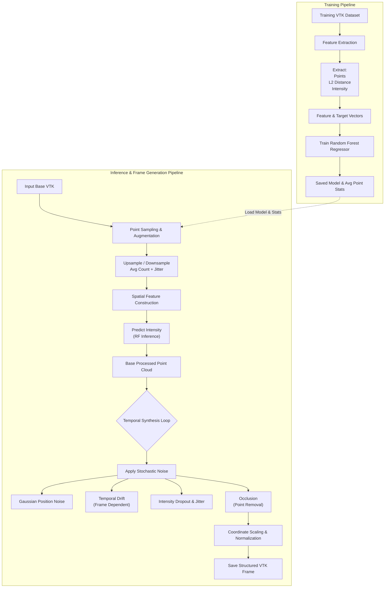
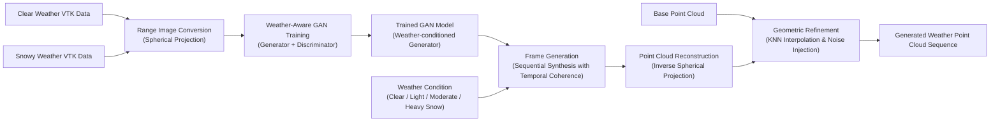

# Caterpillar Weather Prediction Project v2

This project aims to create additional lidar data for adverse weather conditions from the existing limited adverse weather data.


## Data availability

This repository is a data-free copy of `caterpillar-weather-pred`. The VTK weather data has been removed because it is the intellectual property (IP) of Caterpillar Inc.

Both `data/` and `src/utils/Clustering/Data/` contain only a notice. The original data archives, clustering results, and generated HTML previews with embedded point clouds are also omitted. Supply your own authorized data locally before running training or generation. The source code is unchanged; pass paths for your local data where needed.

This copy starts with a fresh Git history so the removed data is not retained in earlier commits.

## Overall Architecture 
### High Level Architecture


### Random Forest Training & Inference Pipeline



### GAN-Based Weather Generation Pipeline




## repository structure
- data/ : training data is given by creating subfolder here
- src/ : contains main driver code and utility functions inside /utils
- outputs/ : contains generated .vtk files of each run within subfolders 


## Usage

- python gen_frame_run.py [-- OPTIONS]


## Command-Line Options

### Input/Output Paths

- `--train_dir` *(str, default: `caterpillar-weather-pred/data/snow_extracted`)*  
  Path to the directory containing VTK files used for training.

- `--input_vtk` *(str, default: `caterpillar-weather-pred/data/input.vtk`)*  
  Path to a single VTK file used as input for frame generation.

- `--output_dir` *(str, default: `caterpillar-weather-pred/outputs`)*  
  Base directory to store output frames. A timestamped subfolder will be created for each run.

NOTE: please use the above 3 options when running `python gen_frame_run.py` and provide paths to the respective folders and files from your present working directory

NOTE: use `--train` flag to train model when training from scratch ( when running for first time )


### Coordinate Scaling

- `--x-limits` *(float, float, default: `0.0 1.0`)*  
  X coordinate limits (min_x max_x)

- `--y-limits` *(float, float, default: `0.0 1.0`)*  
  Y coordinate limits (min_y max_y)

- `--z-limits` *(float, float, default: `0.0 1.0`)*  
  Z coordinate limits (min_z max_z)

- `--scaling-mode` *(str, default: `independent`)*  
  Scaling mode: `independent` (stretch to fit) or `uniform` (preserve aspect ratio)

### Model Management

- `--model-path` *(str, default: `./outputs/model/trained_gan_model.pth`)*  
  Path to save/load the trained GAN model

- `--force-retrain` *(flag)*  
  Force retraining even if model exists

- `--train`   *(flag)*
    train model from scratch


### Frame Generation

- `--duration_s` *(float, default: `2.0`)*  
  Duration in seconds for the output frame sequence.

- `--frequency_hz` *(float, default: `20.0`)*  
  Number of frames per second. Total frames = `duration_s × frequency_hz`.

---

### Noise & Augmentation

- `--position_noise_std` *(float, default: `0.01`)*  
  Standard deviation of noise added to point positions.

- `--intensity_noise_std` *(float, default: `0.02`)*  
  Standard deviation of noise added to intensity values.

- `--jitter_std` *(float, default: `0.001`)*  
  Jitter added to simulate scanning instability.

- `--temporal_noise_std` *(float, default: `0.002`)*  
  Temporal fluctuation in point movement across frames.

- `--occlusion_prob` *(float, default: `0.1`)*  
  Probability of randomly dropping points to simulate occlusion.

- `--intensity_dropout_prob` *(float, default: `0.05`)*  
  Probability of randomly zeroing intensity values.

- `--temporal_clustering_prob` *(float, default: `0.1`)*  
  Probability that nearby points will move together over time.

---

### Coordinate Limits

- `--x_limits` *(float float, default: `0.0 1.0`)*  
  Min and max values allowed along the X axis.

- `--y_limits` *(float float, default: `0.0 1.0`)*  
  Min and max values allowed along the Y axis.

- `--z_limits` *(float float, default: `0.0 1.0`)*  
  Min and max values allowed along the Z axis.

---

### Scaling

- `--uniform` *(flag, default: `False`)*  
  If passed, uniform scaling will be applied across all axes. Otherwise, scaling is axis-specific.

> 💡 Use `--uniform` without a value to enable it.


---

## GAN Weather Sequence Generation

### Weather Conditions

- `--weather-conditions` *(list, required)*  
  Weather conditions to generate in sequence. Options: `CLEAR`, `LIGHT_SNOW`, `MODERATE_SNOW`, `HEAVY_SNOW`

- `--durations` *(list, required)*  
  Duration in seconds for each weather condition (must match number of weather conditions)

### Generation Parameters

- `--frame-interval` *(int, default: `10`)*  
  Frame interval in seconds between generated frames

- `--output-dir` *(str, default: `outputs/gan`)*  
  Output directory for generated VTK files


### Example Commands

  ```bash
# First run - train and save model
python src/utils/sequential_gan.py --weather-conditions CLEAR LIGHT_SNOW HEAVY_SNOW --durations 30 45 60

# Subsequent runs - use saved model
python src/utils/sequential_gan.py --weather-conditions HEAVY_SNOW --durations 120

# Force retrain with custom model path
python src/utils/sequential_gan.py --weather-conditions CLEAR --durations 60 --force-retrain --model-path my_model.pth
```
---

## GAN-Based Weather Sequence Generation

The GAN consists of two main components:
- **WeatherAwareGenerator**: Transforms input LiDAR range images into weather-specific outputs using weather condition embeddings and temporal noise
- **WeatherAwareDiscriminator**: Evaluates the realism of generated weather sequences

The system creates sequential weather transitions, applying physics-based weather effects including:
- Distance-based intensity decay
- Weather-specific noise patterns
- Point density variations
- Snow drift effects for heavy weather conditions
- Coordinate scaling and bounding box constraints

### Usage
> 💡 **Note**: All commands must be run from the parent directory (`caterpillar-weather-pred`)

```bash
python src/utils/sequential_gan.py [-- OPTIONS]
```

### Command-Line Options

#### Weather Sequence Configuration

- `--weather-conditions` *(CLEAR | LIGHT_SNOW | MODERATE_SNOW | HEAVY_SNOW, required)*  
  Weather conditions to generate. Can specify multiple conditions for sequential generation.

- `--durations` *(int, required)*  
  Duration in seconds for each weather condition. Must match the number of weather conditions specified.

- `--frame-interval` *(int, default: `10`)*  
  Frame interval in seconds between generated frames.

#### Output Configuration

- `--output-dir` *(str, default: `outputs/gan`)*  
  Base directory to store generated weather sequences. Creates subfolders for each weather condition.

#### Coordinate Scaling

The GAN now includes the same scaling functionality as the traditional ML model (`scaling_run.py`), ensuring consistent bounding boxes across all generated data.

- `--x-limits` *(float float, default: `-10.0 10.0`)*
  Min and max values for X coordinates. Must provide two values: `min_x max_x`.

- `--y-limits` *(float float, default: `-5.0 5.0`)*
  Min and max values for Y coordinates. Must provide two values: `min_y max_y`.

- `--z-limits` *(float float, default: `0.0 15.0`)*
  Min and max values for Z coordinates. Must provide two values: `min_z max_z`.

- `--scaling-mode` *(independent | uniform, default: `independent`)*  
  Scaling behavior:
  - `independent`: Each axis scales independently to fit the specified limits (may distort aspect ratio)
  - `uniform`: Uniform scaling preserves aspect ratio by fitting within the specified limits

### Sample Usage

```bash
# Generate a simple clear weather sequence with default scaling
python src/utils/sequential_gan.py --weather-conditions CLEAR --durations 60

# Generate a weather transition sequence with custom coordinate limits
python src/utils/sequential_gan.py --weather-conditions CLEAR LIGHT_SNOW HEAVY_SNOW --durations 30 45 60 --x-limits -15.0 15.0 --y-limits -8.0 8.0 --z-limits 0.0 20.0

# Use uniform scaling to preserve aspect ratio
python src/utils/sequential_gan.py --weather-conditions CLEAR MODERATE_SNOW --durations 40 50 --scaling-mode uniform --x-limits -10.0 10.0 --y-limits -5.0 5.0 --z-limits 0.0 15.0

# Custom frame interval and output directory with scaling
python src/utils/sequential_gan.py --weather-conditions CLEAR MODERATE_SNOW --durations 40 50 --frame-interval 5 --output-dir /custom/output --x-limits -12.0 12.0 --y-limits -6.0 6.0 --z-limits 0.0 18.0
```

### Output Structure

Generated files are organized in weather-specific subfolders:

```
outputs/gan/
├── clear/
│   ├── clear_20241201_120000.vtk
│   ├── clear_20241201_120010.vtk
│   └── ...
├── light_snow/
│   ├── light_snow_20241201_120030.vtk
│   ├── light_snow_20241201_120040.vtk
│   └── ...
├── moderate_snow/
│   └── ...
└── heavy_snow/
    └── ...
```

### Training Data Requirements

The GAN requires two VTK files for training:
- `data/clear_day.vtk` - Clear weather LiDAR data
- `data/snowwy.vtk` - Snowy weather LiDAR data

> 💡 The training data paths are fixed and should be placed in the `data/` directory.


